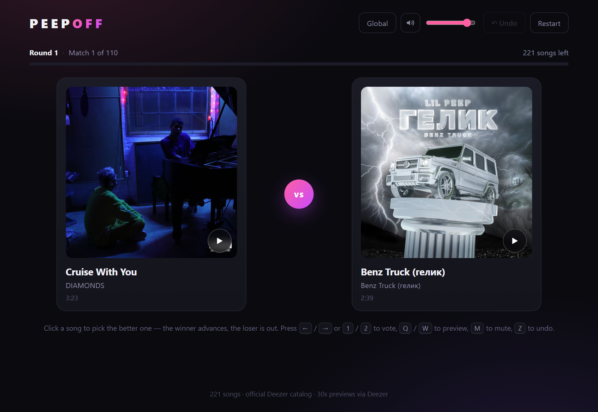
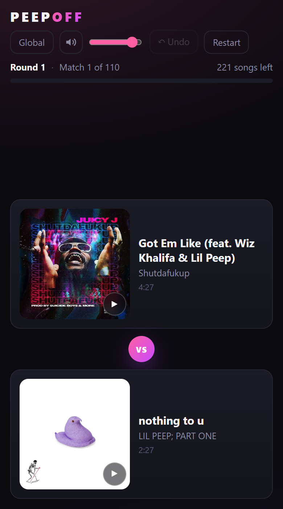
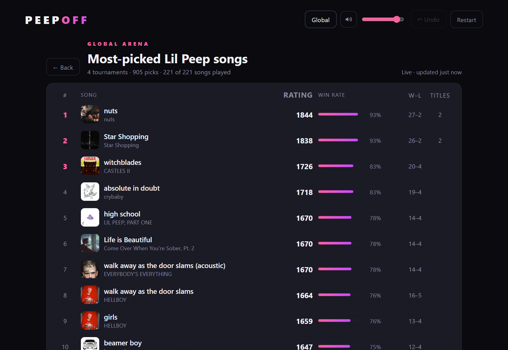

# PeepOff

A for-fun bracket for Lil Peep's discography: two songs show up, you pick the better one, the winner moves on, the loser is out. Repeat until one song is left.

**[Play it → radiant-rodent.github.io/PeepOff](https://radiant-rodent.github.io/PeepOff/)**



There are 311 tracks (including unreleased favorites) in the draw, and the pairings get re-shuffled every round, so no two brackets play out the same. A full run is 310 picks. 30-second previews are available for every track, so you can actually listen before deciding.



## The global board

Every pick is also counted on a shared leaderboard, ranked Elo-style (1500 = average). Play enough and it turns into a rough community ranking of his best songs.



## Keyboard

`1` / `2` or `←` / `→` to vote · `Q` / `W` to preview the left/right song · `M` to mute · `Z` to undo. Progress saves automatically, so you can close the tab mid-bracket and pick it back up later.

## How it's put together

Static files on GitHub Pages. No server, no build step, no framework.

- `songs.js` — the catalog, generated from the Deezer API (see `update-songs.mjs`)
- `app.js` — bracket, voting, previews, local save
- `stats.js` — the shared leaderboard
- `supabase/schema.sql` — the leaderboard's database schema
- `.github/workflows/deploy.yml` — builds and deploys on every push

The leaderboard is a Supabase Postgres project. Votes are append-only: anonymous clients can insert weighted rows and read the aggregate views, and nothing else. No sign-in, and no way to edit or delete anyone's picks. `stats.js` queues votes locally and flushes them in batches, so the board still works if you're offline.

### Run it locally

Open `index.html`. That's it.

For the global board, copy `stats-config.example.js` to `stats-config.js` and drop in your Supabase project URL and anon key — without it the game still works and votes just queue up locally. The schema lives in `supabase/schema.sql`.

### Refresh the catalog

```bash
node update-songs.mjs
```

Curated archive tracks and features live in `unreleased-songs.json` (including numeric Deezer IDs for features absent from the artist-page import). `catalog-overrides.json` preserves canonical project names and matching covers for streaming entries. The generator merges these by ID, so a refresh cannot duplicate the same ID or collapse the two different songs called “Kiss Me” during the curated merge.

Use the [estate's music index](https://lilpeep.com/pages/music) and its linked tracklists as the primary reference for names, albums, and artwork. Compare the artwork itself, not just the archive filename. Keep song IDs unchanged when correcting metadata so leaderboard history stays attached. The additions documented in `CATALOG-AUDIT.md` require an actual vocal contribution from Peep; hooks, choruses, and outros count, not just separate verses.

Run the catalog checks with `node --test tests/catalog.test.mjs`.

## Notes

Fan project, not affiliated with Lil Peep's estate. Includes both official streaming tracks and popular unreleased cuts preserved via archival audio.
